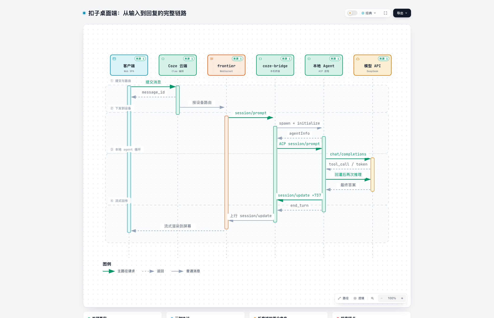
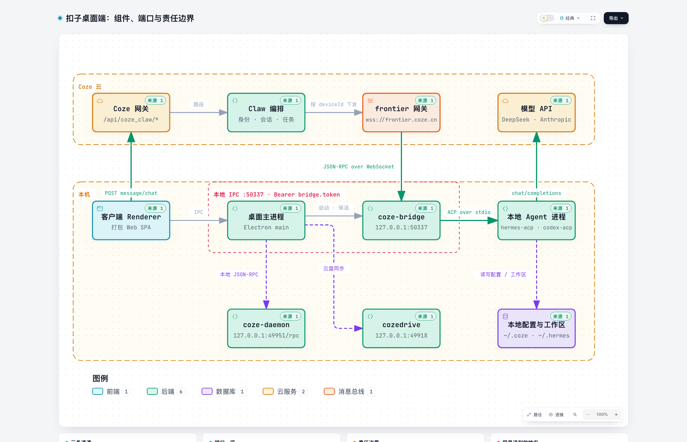
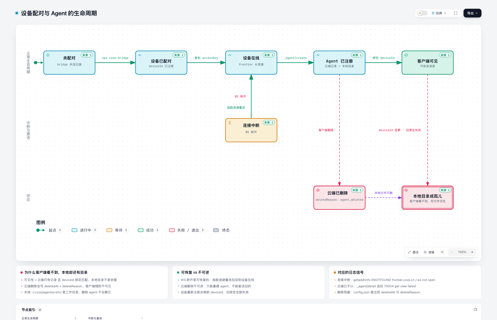

# Coze Agent Notes

对「扣子（Coze）桌面客户端」的一次独立逆向与数据流梳理：**从你在输入框敲下一句话，到屏幕上出现回复**，中间经过了哪些进程、协议、网关。

> ⚠️ 独立研究笔记，**非官方文档**。内容基于本机安装的扣子桌面版（Electron，`cn.coze.desktop`）的 `app.asar`、本地运行时 `~/.coze` 与 `~/.hermes` 的代码与日志观测。
> 所有个人标识（user_id / agentId / deviceId / 会话 ID / 本机路径）均已脱敏为 `<...>` 占位符；任何 token、密钥一律未收录。

## 在线站点

GitHub Pages：https://webaifei.github.io/coze-agent-notes/

由仓库根目录的 Jekyll 构建发布（`_config.yml` 提供站点元信息）。三张交互式图在线上可直接打开：

- [时序图](https://webaifei.github.io/coze-agent-notes/diagrams/coze-desktop-agent-sequence.html)
- [架构图](https://webaifei.github.io/coze-agent-notes/diagrams/coze-desktop-agent-architecture.html)
- [生命周期图](https://webaifei.github.io/coze-agent-notes/diagrams/coze-device-agent-lifecycle.html)

> 仓库另带一个 GitHub Actions 工作流（`.github/workflows/pages.yml`）与 `scripts/build_site.py`，
> 可在 Pages 源切换为 "GitHub Actions" 时提供一套自带样式的静态站点。

## 一句话结论

```
输入框 → 云端 HTTP API → 云端 Claw 编排 → frontier 长连接下行
      → 本地 coze-bridge → ACP over stdio → 本地 agent 进程（hermes / codex）
      → 模型 API → 原路流式返回 → 前端增量渲染
```

**云端管「谁和谁说话」，bridge 管「怎么说」，本地 agent 管「怎么想」。**

## 目录

| 文档 | 内容 |
|---|---|
| [01-architecture.md](docs/01-architecture.md) | 组件、责任边界、进程与端口、数据落盘位置 |
| [02-message-dataflow.md](docs/02-message-dataflow.md) | 端到端 8 跳，逐跳真实载荷与一轮完整时序 |
| [03-protocols-and-runtime.md](docs/03-protocols-and-runtime.md) | frontier JSON-RPC、ACP、会话映射、凭证模型、框架适配 |
| [04-troubleshooting.md](docs/04-troubleshooting.md) | 日志地图 + 三种典型故障的判别口诀 |
| [05-ecosystem.md](docs/05-ecosystem.md) | 官方仓库版图；coze-studio / CozeLoop SDK / DAG 与 agent loop 的区别 |
| [时序图](diagrams/coze-desktop-agent-sequence.html) | 从输入到回复的端到端时序 |
| [架构图](diagrams/coze-desktop-agent-architecture.html) | 组件、端口与责任边界 |
| [生命周期图](diagrams/coze-device-agent-lifecycle.html) | 设备配对与 Agent 的创建 / 删除 |

## 图

三张交互式图（内联 SVG，明暗主题 / 路径高亮 / 搜索缩放 / 导出 PNG·SVG），源文件是对应的 JSON。

### 1. 时序图 —— 从输入到回复



[打开交互版](diagrams/coze-desktop-agent-sequence.html) · [可编辑源](diagrams/coze-desktop-agent-sequence.json)

> 8 个参与者超出画布宽度上限，故收敛为 6 列核心链路；「用户」与「本地配置」两个角色以卡片说明。

### 2. 架构图 —— 组件、端口与责任边界



[打开交互版](diagrams/coze-desktop-agent-architecture.html) · [可编辑源](diagrams/coze-desktop-agent-architecture.json)

### 3. 生命周期图 —— 设备配对与 Agent 的生死



[打开交互版](diagrams/coze-device-agent-lifecycle.html) · [可编辑源](diagrams/coze-device-agent-lifecycle.json)

> 这张图解释了「客户端看不到，但本地还有目录」：可见性取决于云端记录与 deviceId 绑定，本地目录只是工作区。

## 关键事实速览

- renderer **从不直连本地 agent**，它只和云端说话。
- `coze-bridge` 是 **WebSocket 客户端**（主动外连 `wss://frontier.coze.cn`），**不监听入站 TCP** 做业务。
- bridge 本身**不做推理**，它只做协议翻译：`frontier JSON-RPC` ⟷ `ACP`。
- 真正的 agent loop 在本地 agent 进程里（如 `hermes-acp`），它甚至不知道 Coze 的存在。
- 「本地 agent 用哪个模型」由**本地 agent 自己的配置**决定，不由云端下发（`deployType=local` 时）。
- 客户端看不到某个 agent ≠ 本地文件被删：客户端列表以**云端 + deviceId 绑定**为准，本地目录可能只是孤儿。
