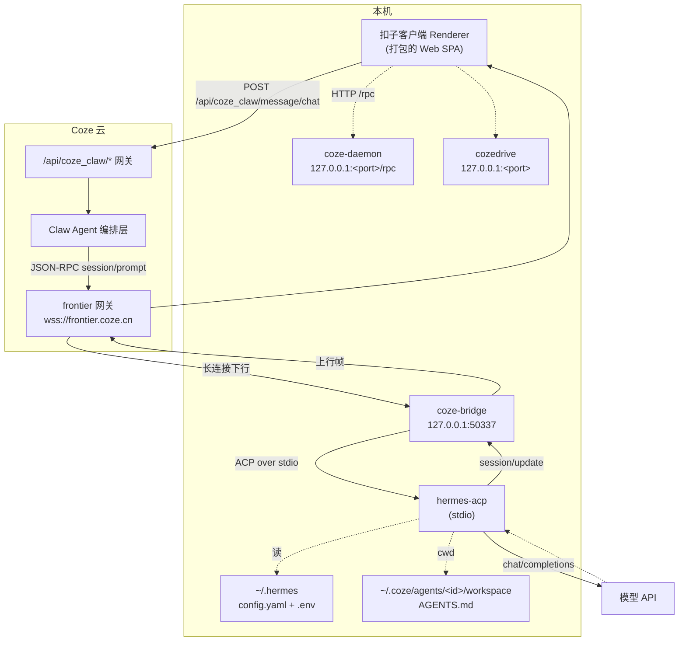

# 01 · 架构与责任边界

## 全景

## 责任边界

| 组件 | 位置 | 职责 | 不负责 |
|---|---|---|---|
| Renderer（客户端前端） | 本机 | 收集输入、展示流式结果 | 不直连本地 agent |
| 云端 Claw 编排 | 云 | 身份、会话、任务排队、路由到设备 | 不执行你的本地工具 |
| **frontier** | 云 ↔ 本机 | 设备侧主动外连的双向长连接（JSON-RPC） | 不解析业务 |
| **coze-bridge** | 本机 | **协议翻译**：frontier JSON-RPC ⟷ ACP | 不做推理、不碰模型 |
| **本地 agent 进程** | 本机 | **agent loop**：调模型、执行工具、维护会话 | 不知道 Coze 的存在 |
| coze-daemon | 本机 | 本地控制面 JSON-RPC（供主进程管理运行时） | 不参与对话 |
| cozedrive | 本机 | 云盘本地服务 | 不参与对话 |

## 进程与端口（本机实测）

| 进程 | 监听 | 说明 |
|---|---|---|
| `coze-bridge`（Node） | `127.0.0.1:50337` | 需 Bearer token；`GET /status` 返回运行状态与 agent 列表 |
| `coze-daemon` | `127.0.0.1:<port>/rpc` | 本地控制面 JSON-RPC |
| `cozedrive` | `127.0.0.1:<port>` | 云盘 |
| `hermes-acp` / `codex` | 无监听 | 由 bridge 以 stdio 拉起，**懒加载**：首次发消息才 spawn |

## 落盘位置

| 内容 | 路径 |
|---|---|
| bridge 日志 | `~/.coze/bridge/logs/bridge-YYYY-MM-DD.log` |
| bridge 端口/令牌 | `~/.coze/bridge/bridge.port`、`bridge.token` |
| 设备配对信息 | `~/.coze/bridge/connection.json`（含 PAT，敏感） |
| agent 列表与配置 | `~/.coze/agents/<agentId>/config.json` |
| agent 工作区（= 系统提示词） | `~/.coze/agents/<agentId>/workspace/AGENTS.md` |
| agent 日志 | `~/.coze/agents/<agentId>/logs/agent-YYYY-MM-DD.log` |
| 本地 agent 会话 | `~/.hermes/sessions/session_<acpSessionId>.json` |
| 模型调用失败转储 | `~/.hermes/sessions/request_dump_*.json` |
| 组件框架缓存 | `~/.coze/bridge/config.json` 的 `frameworksCache` |

## 关于 "Coze agent" 的三个层次

1. **云端 Claw Agent** — 身份、权限、会话与任务编排（不跑你的本地命令）
2. **coze-bridge** — 把云端指令翻译成本地 agent 能懂的 ACP
3. **本地 agent 进程** — 真正循环、调模型、执行工具的那一层

日常口语里的「我的 Coze agent」，指的是 1 的身份 + 3 的进程，2 是它们之间的胶水。
